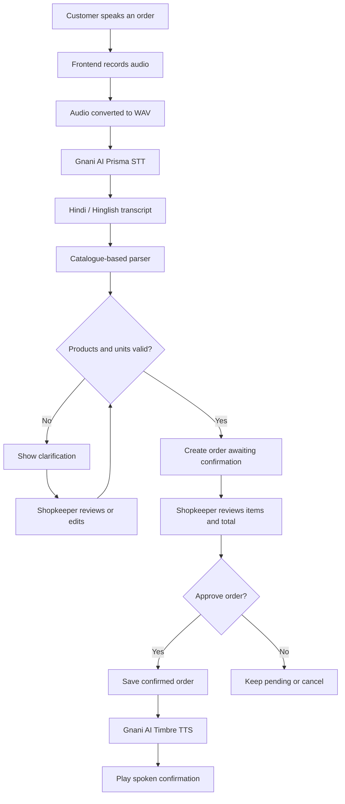

<div align="center">

# BharatVoice

### Voice-first commerce for India's local stores

**Turn natural Hindi, Hinglish and English conversations into structured grocery orders.**

[](https://bharatvoice-frontend-wope.onrender.com)
[](https://bharatvoice-backend-e3v8.onrender.com)

[**Launch Live Application →**](https://bharatvoice-frontend-wope.onrender.com)

</div>

---

## Homepage


---

## What is BharatVoice?

BharatVoice is a voice-based AI ordering assistant designed for neighbourhood kirana stores and local retailers in India.

A customer can say:

> “भैया, दो किलो आटा और एक लीटर दूध दे देना।”

BharatVoice transcribes the speech, extracts products and quantities, validates them against a catalogue, and creates an order for the shopkeeper to review. An order is never confirmed automatically: the shopkeeper must explicitly approve it.

## Live links

| Resource | Link |
|---|---|
| Live frontend | https://bharatvoice-frontend-wope.onrender.com |
| Backend API | https://bharatvoice-backend-e3v8.onrender.com |
| Swagger API documentation | https://bharatvoice-backend-e3v8.onrender.com/docs |

> **Hosting note:** The Render free backend may spin down after inactivity, which can delay the first request. The free PostgreSQL database also has a limited lifetime.

## Features

- Voice-based grocery ordering.
- Hindi, Hinglish and English conversation support.
- Speech-to-text using Gnani AI Prisma.
- Catalogue-based product and quantity extraction.
- Product and unit validation.
- Clarification handling for unsupported or ambiguous items.
- Shopkeeper review and explicit order approval.
- Order editing, confirmation and cancellation.
- Hindi spoken confirmation using Gnani AI Timbre.
- Persistent order storage.
- Dashboard with order totals and status distribution.

## End-to-end workflow



### Typical user journey

1. Open **Voice Orders**.
2. Record the customer's spoken grocery request.
3. Gnani AI Prisma converts speech into text.
4. BharatVoice extracts products, quantities and units.
5. Unsupported units or unclear items are flagged for clarification.
6. The shopkeeper reviews the items and estimated total.
7. The shopkeeper confirms or cancels the order.
8. Gnani AI Timbre generates spoken confirmation audio.

## Technology stack

| Layer | Technologies |
|---|---|
| Frontend | React, TypeScript, Vite, CSS |
| Backend | Python, FastAPI, Pydantic |
| Database / ORM | PostgreSQL in production, SQLite locally, SQLAlchemy |
| Speech-to-text | Gnani AI Prisma |
| Text-to-speech | Gnani AI Timbre |
| HTTP client | HTTPX |
| Testing | Pytest |
| Deployment | Render Static Site, Web Service and PostgreSQL |

## Architecture

```text
React + TypeScript Frontend
          │ REST API
          ▼
       FastAPI
          │
   ┌──────┼──────────┐
   ▼      ▼          ▼
 Prisma  Order     Timbre
  STT    Parser     TTS
          │
          ▼
    SQLAlchemy ORM
          │
     PostgreSQL
```

## Order lifecycle

- `draft` — order is being prepared.
- `needs_clarification` — an item or unit needs attention.
- `awaiting_confirmation` — ready for shopkeeper approval.
- `confirmed` — explicitly approved by the shopkeeper.
- `cancelled` — cancelled order.

## API overview

See the live [Swagger documentation](https://bharatvoice-backend-e3v8.onrender.com/docs) for current schemas and examples.

| Method | Endpoint | Purpose |
|---|---|---|
| `GET` | `/api/orders` | List saved orders |
| `POST` | `/api/orders/parse` | Parse text without saving an order |
| `POST` | `/api/transcribe` | Transcribe uploaded audio |
| `POST` | `/api/orders/voice` | Create an order from voice input |
| `GET` | `/api/orders/{order_id}` | Retrieve an order |
| `PATCH` | `/api/orders/{order_id}` | Update order items |
| `POST` | `/api/orders/{order_id}/confirm` | Confirm an order |
| `POST` | `/api/orders/{order_id}/cancel` | Cancel an order |
| `POST` | `/api/orders/{order_id}/speak-confirmation` | Generate spoken confirmation |

## Run locally

### Prerequisites

- Python 3.13+
- Node.js and npm
- Git

### 1. Clone the repository

```bash
git clone https://github.com/Siddharth8445/BharatVoice.git
cd BharatVoice
```

### 2. Set up the backend

```powershell
cd backend
python -m venv .venv
.venv\Scripts\Activate.ps1
pip install -r requirements.txt
```

Create `backend/.env` using `.env.example` as a reference. Example local settings:

```env
ENVIRONMENT=development
DATABASE_URL=sqlite:///./bharatvoice.db
USE_MOCK_GNANI=true
GNANI_API_KEY=
CORS_ORIGINS=http://localhost:5173
```

Add your own Gnani AI credentials if testing live speech services. Never commit `.env` or expose API keys.

Run the backend:

```bash
uvicorn app.main:app --reload --host 0.0.0.0 --port 8000
```

Backend: `http://localhost:8000`  
API docs: `http://localhost:8000/docs`

### 3. Set up the frontend

Open a second terminal:

```bash
cd frontend
npm install
```

Create `frontend/.env.local`:

```env
VITE_API_BASE_URL=http://localhost:8000
```

Run the frontend:

```bash
npm run dev
```

Frontend: `http://localhost:5173`

> Variables prefixed with `VITE_` are exposed to the browser. Never put API keys or other secrets in frontend environment variables.

## Testing

From the `backend` directory, with the virtual environment activated:

```bash
pytest -v
```

Build the frontend:

```bash
cd frontend
npm run build
```

The backend test suite passed **60 tests** during development.

## Deployment

BharatVoice is deployed on Render:

- **Frontend:** Render Static Site built from `frontend/`.
- **Backend:** Render Web Service built from `backend/`.
- **Database:** Render PostgreSQL.
- **AI speech services:** Gnani AI credentials configured as backend environment secrets.

The frontend uses `VITE_API_BASE_URL` to reach the deployed backend. Production secrets and database connection strings are configured in Render and must not be committed to Git.

## Security and design principles

- Keep Gnani AI API credentials on the backend.
- Do not commit `.env`, database URLs or secrets.
- Restrict production CORS to the deployed frontend origin.
- Require shopkeeper approval before an order becomes confirmed.
- Flag uncertain products and unsupported units rather than silently guessing.

## Project status

The deployed demonstration has been tested for live speech transcription, product extraction, invalid-unit clarification, order review, confirmation and cancellation, database persistence, and spoken confirmation.

## Future improvements

- Expand regional language and local product-name coverage.
- Add store-specific catalogues and pricing.
- Improve mobile-first usability and accessibility.
- Add production monitoring and persistent database hosting.

## Author

**Siddharth Kumar**  
B.Tech Computer Science and Engineering — Data Science

- GitHub: [@Siddharth8445](https://github.com/Siddharth8445)
- Repository: [BharatVoice](https://github.com/Siddharth8445/BharatVoice)

---

<div align="center">

**Built to make local commerce more accessible through voice.**

[Live Demo](https://bharatvoice-frontend-wope.onrender.com) · [API Docs](https://bharatvoice-backend-e3v8.onrender.com/docs) · [GitHub](https://github.com/Siddharth8445/BharatVoice)

</div>
