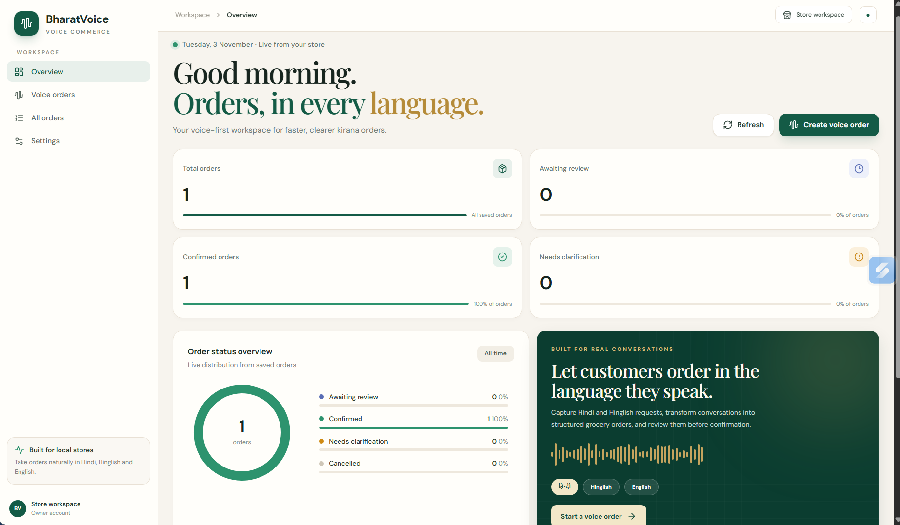

# BharatVoice

### Voice-first commerce for India's local stores

**Turn natural Hindi, Hinglish and English conversations into structured grocery orders.**

[**Launch Live Application →**](https://bharatvoice-frontend-wope.onrender.com)

---

## Homepage

---

📌 Overview

BharatVoice is an AI-powered voice commerce platform designed to simplify ordering for India's local kirana stores.

Traditional ordering often requires customers to type product names, quantities, and units manually. BharatVoice makes this process conversational.

Customers can simply speak in Hindi or Hinglish:

Example:

"भैया, दो किलो आटा और एक लीटर दूध भेज देना।"

BharatVoice converts the speech into text, identifies products and quantities, validates the order, and presents it to the shopkeeper for review and confirmation.

The platform combines speech recognition, deterministic product parsing, order validation, database persistence, and speech synthesis into one complete workflow.

🎯 Problem Statement

Millions of local kirana stores serve customers who are more comfortable communicating in regional languages than typing orders into digital applications.

Existing digital ordering systems can create friction through:

Manual product searching.

Language barriers.

Incorrect product quantities or units.

Complicated ordering interfaces.

Lack of simple voice-based workflows.

BharatVoice aims to make digital ordering as natural as speaking to a local shopkeeper.

✨ Key Features

🎙️ Voice-Based Ordering

Record customer orders directly through the browser.

Supports Hindi and Hinglish speech.

Converts recorded audio into a supported WAV format.

Integrates Gnani AI Prisma Speech-to-Text.

🧠 Intelligent Order Parsing

Extracts product names, quantities, and units.

Supports Hindi, Hinglish, and English product aliases.

Recognizes supported number words.

Uses a deterministic product catalogue.

Identifies ambiguous or unsupported products.

🛡️ Smart Validation and Clarification

Validates products against the catalogue.

Checks product-specific measurement units.

Prevents invalid items from being confirmed.

Requests clarification instead of guessing.

📦 Order Management

Creates draft orders from voice input.

Allows shopkeepers to edit order items.

Calculates order totals.

Supports order confirmation and cancellation.

Maintains order history and status.

🔊 Hindi Voice Confirmation

Integrates Gnani AI Timbre Text-to-Speech.

Generates spoken Hindi order confirmations.

Returns generated audio for playback.

📊 Dashboard

Displays order statistics.

Shows recent orders.

Provides order status visibility.

Offers a premium ivory-and-green interface.

🏗️ System Architecture

flowchart TD
    A["Customer"] --> B["React Frontend"]
    B --> C["Voice Recording"]
    C --> D["Audio Conversion: WebM to WAV"]
    D --> E["FastAPI Backend"]
    E --> F["Gnani AI Prisma STT"]
    F --> G["Hindi / Hinglish Transcript"]
    G --> H["Product Parser"]
    H --> I["Catalogue & Unit Validation"]
    I --> J{"Order Valid?"}
    J -->|No| K["Clarification Required"]
    K --> B
    J -->|Yes| L["Order Review"]
    L --> M{"Shopkeeper Approval"}
    M -->|Edit| L
    M -->|Cancel| N["Cancelled"]
    M -->|Confirm| O["PostgreSQL Database"]
    O --> P["Gnani AI Timbre TTS"]
    P --> Q["Hindi Voice Confirmation"]
    Q --> B

Architecture Components

Layer

Responsibility

Technology

Frontend

User interface and voice recording

React, TypeScript

API Layer

Request handling and routing

FastAPI

Speech Recognition

Speech-to-text conversion

Gnani AI Prisma

Order Processing

Product extraction and validation

Python

Data Validation

DTO and schema validation

Pydantic

Persistence

Order and catalogue data

SQLAlchemy, PostgreSQL

Speech Generation

Hindi voice confirmation

Gnani AI Timbre

Deployment

Frontend and backend hosting

Render

🔄 Complete Application Workflow

1. Customer Speaks

The customer records an order using the microphone.

Example:

"मुझे दो किलो आटा और एक लीटर दूध चाहिए।"

2. Audio Processing

The frontend records audio and converts browser-generated WebM audio into mono 16 kHz PCM WAV format for compatibility with the speech recognition API.

3. Speech-to-Text

Gnani AI Prisma processes the audio and returns the recognized transcript.

4. Product Extraction

The backend parser identifies:

Product: Atta

Quantity: 2

Unit: kg

Product: Milk

Quantity: 1

Unit: litre

5. Product and Unit Validation

The system checks whether the products exist in the catalogue and whether their measurement units are supported.

If a customer requests an invalid combination, such as 1 kg of milk, the application requests clarification.

6. Order Review

The shopkeeper reviews the extracted items, edits quantities if necessary, and checks the calculated total.

7. Order Confirmation

The shopkeeper explicitly confirms or cancels the order.

No order is automatically confirmed.

8. Database Persistence

The order and its status are stored in the database.

9. Voice Confirmation

Gnani AI Timbre generates a Hindi audio confirmation that can be played through the frontend.

🧰 Technology Stack

Frontend

React

TypeScript

Vite

Axios

CSS

Lucide React

Backend

Python 3.13

FastAPI

Pydantic

SQLAlchemy

HTTPX

AI and Speech

Gnani AI Prisma v3.0 — Speech-to-Text

Gnani AI Timbre v2.5 — Text-to-Speech

Database

SQLite — Local development

PostgreSQL — Production deployment

Deployment and Tools

Render

Git and GitHub

Swagger / OpenAPI

Pytest

📂 Project Structure

BharatVoice/
│
├── backend/
│   ├── app/
│   │   ├── api/
│   │   │   └── routes/
│   │   │       ├── health.py
│   │   │       ├── orders.py
│   │   │       └── speech.py
│   │   │
│   │   ├── core/
│   │   │   └── config.py
│   │   │
│   │   ├── db/
│   │   │   └── session.py
│   │   │
│   │   ├── models/
│   │   ├── schemas/
│   │   ├── services/
│   │   │   ├── order_service.py
│   │   │   ├── speech_to_text.py
│   │   │   └── text_to_speech.py
│   │   │
│   │   └── main.py
│   │
│   ├── tests/
│   ├── requirements.txt
│   └── migrate_phase8.py
│
├── frontend/
│   ├── src/
│   │   ├── components/
│   │   ├── pages/
│   │   ├── api/
│   │   ├── hooks/
│   │   └── main.tsx
│   │
│   ├── package.json
│   └── vite.config.ts
│
├── .env.example
├── .gitignore
├── IMPLEMENTATION_NOTES.md
└── README.md

⚙️ Local Installation and Setup

Prerequisites

Python 3.13+

Node.js and npm

Git

Gnani AI API credentials

1. Clone the Repository

git clone https://github.com/Siddharth8445/BharatVoice.git
cd BharatVoice

2. Backend Setup

cd backend

python -m venv .venv

.venv\Scripts\Activate.ps1

pip install -r requirements.txt

Create your backend .env file and configure the required variables:

ENVIRONMENT=development
DATABASE_URL=sqlite:///./bharatvoice.db

GNANI_API_KEY=your_gnani_api_key

USE_MOCK_GNANI=false

Keep your real API credentials private. Never commit .env to GitHub.

Start the backend:

uvicorn app.main:app --reload --port 8000

Backend: http://localhost:8000

API documentation: http://localhost:8000/docs

3. Frontend Setup

Open another terminal:

cd frontend

npm install

Create a frontend .env file:

VITE_API_BASE_URL=http://localhost:8000/api

Start the frontend:

npm run dev

Frontend: http://localhost:5173

🚀 Production Deployment

BharatVoice is deployed using Render.

Component

Hosting

Frontend

Render Static Site

Backend

Render Web Service

Production Database

Render PostgreSQL

Speech APIs

Gnani AI

Deployment Configuration

Frontend

Root directory: frontend

Build command: npm install && npm run build

Publish directory: dist

Environment variable: VITE_API_BASE_URL

Backend

Root directory: backend

Build command: pip install -r requirements.txt

Start command:

uvicorn app.main:app --host 0.0.0.0 --port $PORT

Backend environment variables

DATABASE_URL

GNANI_API_KEY

USE_MOCK_GNANI=false

ENVIRONMENT=production

CORS_ORIGINS

🧪 Testing

The backend includes automated tests covering the core application functionality.

Run the test suite:

cd backend

pytest -v

Latest locally verified test result:

60 tests passed.

4 warnings.

No test failures.

The end-to-end validation also covered:

Live Hindi speech transcription.

Product extraction.

Invalid unit detection.

Clarification and correction.

Order confirmation.

Order cancellation.

Database persistence.

Hindi audio generation.

🔐 Security and Reliability

API credentials are stored in environment variables.

.env files are excluded from version control.

Product and unit validation occurs before confirmation.

Ambiguous orders require shopkeeper review.

Orders are not automatically dispatched or confirmed.

Audio uploads have duration and file-size limits.

Database connections use SQLAlchemy.

🛣️ Future Improvements

Support for additional Indian regional languages.

More advanced catalogue management.

Customer and shopkeeper authentication.

Multi-store support.

WhatsApp ordering integration.

Analytics for shopkeepers.

Improved speech recognition in noisy environments.

Inventory and stock management.

👨‍💻 Author

Siddharth Kumar

B.Tech Computer Science and Engineering — Data Science

J.S.S. Academy of Technical Education, Noida

GitHub: https://github.com/Siddharth8445

LinkedIn: https://www.linkedin.com/in/siddharth-kumar-6a1b55380

🙌 Acknowledgements

Gnani AI — Speech-to-Text and Text-to-Speech APIs.

FastAPI — Backend framework.

React — Frontend library.

Render — Cloud deployment.

  <strong>Built with ❤️ to make voice commerce accessible to every Indian kirana store.</strong>
   
  <strong>BharatVoice — भारत की आवाज़, डिजिटल व्यापार के साथ।</strong>

